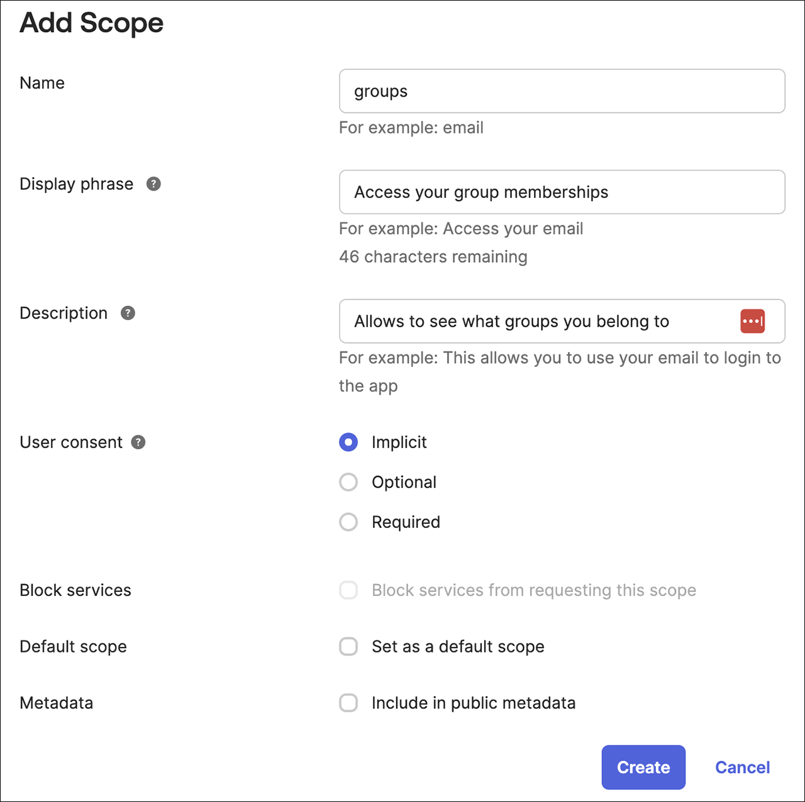
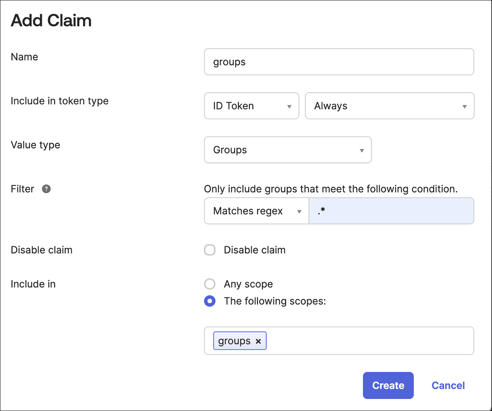
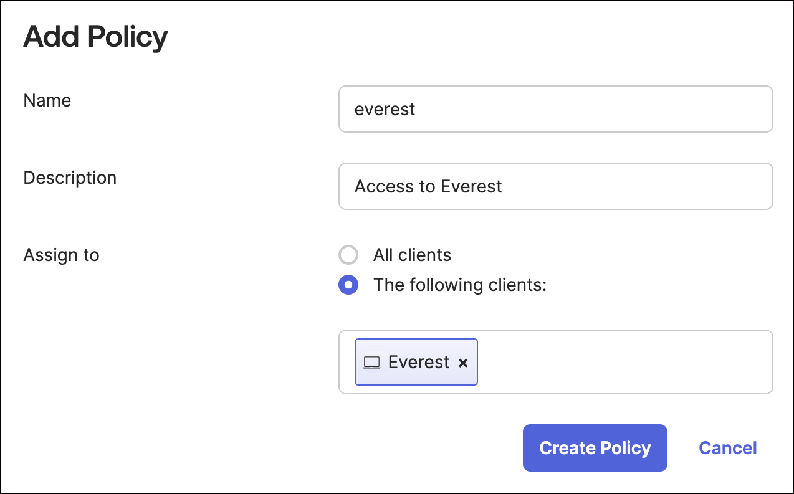
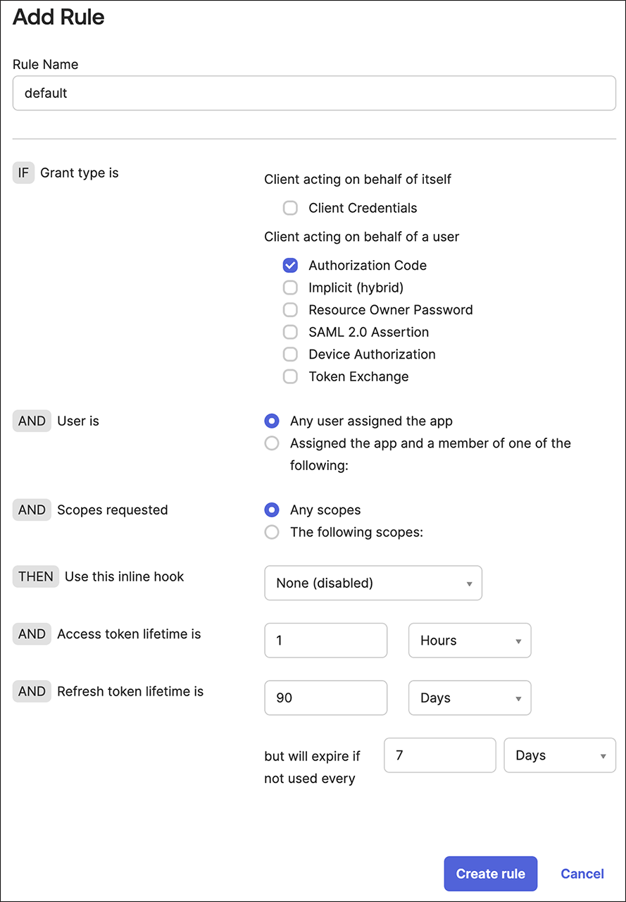

# RBAC: Integration with IdP groups

You can assign RBAC policies to the groups that users belong to in your identity provider (IdP), instead of to each user's unique subject ID (`sub`).

During the SSO authentication, if the group’s scope is requested but the Identity Provider (IdP) lacks the necessary groups claim configuration or does not support it by default, SSO could fail or not function as expected.

A user will be authorized to perform an operation if either their subject or any of the groups they belong to has the required permission. To use IdP groups in OpenEverest RBAC, you would need to set up the groups claim in your IdP provider configuration.

## OKTA

Once you successfully establish an Identity Provider (IdP) integration with Okta, the `issuerURL` in this configuration identifies your API server, serving as a unique identifier for your server within Okta. Additionally, you will have a client application, referred to as the Application integration, which is represented by the `clientID`. This setup allows for secure communication and authentication between your application and Okta's services.

To use IdP groups in OpenEverest RBAC, set up the groups claim in your IdP provider settings. Here are the steps to configure the groups claim:

1. Navigate to **Security > API**.

2. In the list, find the API server that you use and click **Edit**.

3. Click **Scopes > Add Scope**. 

    :::note

    A scope specifies the level and type of access a client application can request from an Identity Provider (IdP) during the authentication process.

    :::
      
    Add a scope called **groups** while keeping all other options to their default settings.

    

4. Click **Create**.

5. Click **Claims > Add Claim**. 

    :::note

    A claim specifies the scope to activate and the information required within that scope.

    :::

    1. Add a claim named **groups**.

    2. Set the **Include in token type** to **ID Token** and choose **Always**.

    3. Change the **Value type** to **Groups**.

    4. Select the **Filter** as **Matches regexp** and add a filter to match the desired Okta groups for Everest, for example: .*.

    5. Set **Include in** to **groups**, which is the scope you created earlier.

    

6. Click **Access Policies > Add Policy**. A policy restricts how this authorization server is used.

    1. Add **Name** and **Description**.

    2. Assign the policy to the client (Application Integration) you created earlier. The field should auto-complete as you type. Create the policy.

    3. Create the policy.

    

7. Add a rule to the policy. A Rule defines the details of usage:

    1. Add a name. If you prefer, you can use **default** option.

    2. Fine-tune the settings to align with your organization's security policy. Here are some suggestions:

        - Uncheck all grant types except for the **Authorization Code**.
        -  Adjust the **token lifetime** to determine how long a session can remain active.
        - Restrict the refresh **token lifetime** or consider deactivating it completely.

        

    3. Click **Create Rule**.

## Configure OpenEverest to request groups

OpenEverest reads group memberships from the `groups` claim of the ID token. Add the `groups` scope to the OIDC configuration, in addition to the default `openid`, `profile` and `email`:

```yaml
server:
  oidc:
    issuerUrl: https://example.okta.com
    clientId: <client-id>
    scopes:
      - openid
      - profile
      - email
      - groups
```

See [Single sign-on](../security/sso_idp_integration.md#configure-openeverest) for how to apply this configuration.

| Scope | Gives access to |
| --- | --- |
| `openid` | The user's unique identifier (`sub`). Required. |
| `profile` | Basic profile information, such as the name. |
| `email` | The email address and whether it is verified. |
| `groups` | The groups the user belongs to. |

:::warning

If OpenEverest requests the `groups` scope but the IdP has no groups claim configured, login can fail. Configure the claim in the IdP first, as shown above for Okta.

:::

## Grant permissions to groups

Use the group name as the subject in the [RBAC policy](rbac.md), exactly as the IdP sends it. Assign a role to a group:

```text
g, Admins, role:admin
```

Or grant permissions directly:

```text
p, ProjectTeam, instances, *, main/project-team/*
```

A user is allowed an action if their subject or any of their groups has the permission.
