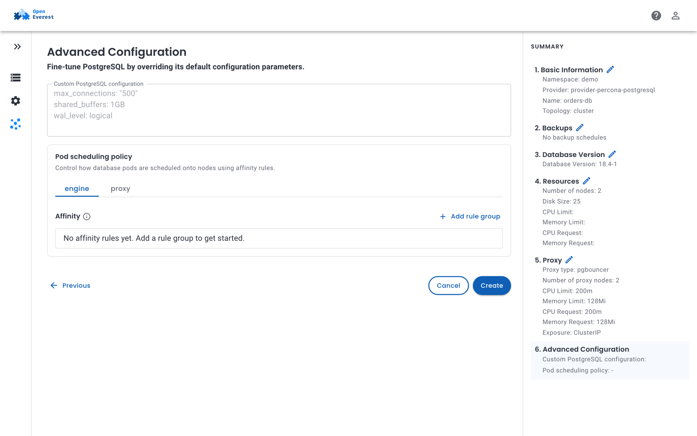

# Pod scheduling

Pod scheduling rules decide on which Kubernetes nodes the pods of an instance run. Use them to keep replicas apart for high availability, to place instances on dedicated or faster nodes, or to keep them away from nodes reserved for other workloads.

Scheduling is configured per **component** — the engine, a proxy, config servers and so on — so each part of an instance can have its own rules.

## Defaults

If you don't set any rules, the provider applies its defaults. Providers typically place each data-bearing member on a different node: the MongoDB and MySQL providers, for example, put each member of a three-member cluster on its own node. A cluster that is too small for this shows a **cannot be scheduled** warning on the instance instead of quietly running two members on the same node.

To turn a default off, set the value to empty — `affinity: {}` or `topologySpreadConstraints: []`. An empty value means *no rules*; an omitted value means *the provider's default*.

## Set rules in the UI

1. When you create an instance, open **Configure more options** and go to the **Advanced Configuration** step. For an existing instance, click **Edit** on the card that holds the pod scheduling policy on the **Overview** tab.
2. Under **Pod scheduling policy**, select the component tab, for example **engine** or **proxy**.
3. Click **Add rule group** and define the affinity rules: node affinity, pod affinity or pod anti-affinity, whether each is required or preferred, and the labels to match.
4. Save.



The pod scheduling editor is available for providers that enable it in their UI schema.

## Set rules with kubectl

Each component has a `schedulingPolicy` with the standard Kubernetes fields:

| Field | Purpose |
| --- | --- |
| `nodeSelector` | Run pods only on nodes with these labels. |
| `affinity` | Node affinity, pod affinity and pod anti-affinity rules. |
| `tolerations` | Allow pods onto nodes with matching taints. |
| `topologySpreadConstraints` | Spread pods evenly across zones or nodes. |
| `schedulerName` | Use a scheduler other than the default one. |

Which fields a component accepts is defined by the provider — check the topology's `supportedFields` in the `Provider` resource.

For example, to run the PostgreSQL engine only on nodes labeled `workload=databases`, tolerate the taint on those nodes, and keep at most one engine pod per zone:

```yaml
spec:
  components:
    engine:
      schedulingPolicy:
        nodeSelector:
          workload: databases
        tolerations:
          - key: workload
            operator: Equal
            value: databases
            effect: NoSchedule
        topologySpreadConstraints:
          - maxSkew: 1
            topologyKey: topology.kubernetes.io/zone
            whenUnsatisfiable: DoNotSchedule
```

Providers built on the OpenEverest provider runtime add the labels of the component's pods to constraints that have no `labelSelector`, so you usually don't need to write one.

## Run a small test cluster

On a cluster with fewer nodes than replicas — for example a single-node local cluster — disable the default anti-affinity:

```yaml
spec:
  components:
    engine:
      replicas: 3
      schedulingPolicy:
        affinity: {}
```
