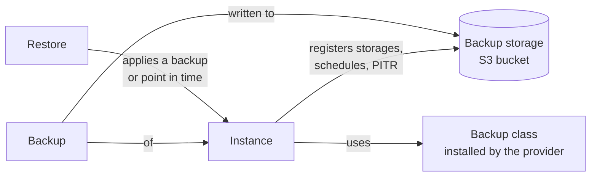

# About backups

OpenEverest gives every technology the same backup workflow — storages, on-demand backups, schedules, point-in-time recovery and restores — while the provider decides how the data is actually backed up, for example with pgBackRest for PostgreSQL or Percona Backup for MongoDB.

:::note

Backup support depends on the provider. Most database providers support backups, and many support point-in-time recovery. Check the provider's capabilities in the Plugin Hub or in its README.

:::

## Building blocks

- **Backup storage** — an S3-compatible bucket, defined once per namespace and shared by the instances in it. See [Backup storage](backup_storage.md).
- **Backup class** — describes how backups are taken for one or more providers. Providers install their backup classes, so you normally just pick one. List them with `kubectl get backupclasses`.
- **Backup** — one backup of an instance, taken on demand or by a schedule.
- **Schedule** — a cron schedule on an instance that writes backups to one storage, with optional retention.
- **Point-in-time recovery (PITR)** — continuous upload of the instance's transaction log to a storage, so you can restore to any moment within the recovery window.
- **Restore** — applies a backup or a point in time to an instance.

## What you can do

| Task | Where |
| --- | --- |
| Add an S3 bucket for backups | **Settings** > **Backups storages** — [Backup storage](backup_storage.md) |
| Take a backup now, or schedule backups | The instance's **Backups** tab — [Create backups](create_backups.md) |
| Enable point-in-time recovery | The instance's **Backups** tab — [Point-in-time recovery](pitr.md) |
| Restore an instance from a backup or a point in time | **Actions** > **Restore from a backup** — [Restore a backup](restore.md) |
| Create a new instance from a backup | **Actions** > **Create DB from a backup** — [Create an instance from a backup](create_from_backup.md) |
| Create an instance from a backup that is already in a bucket | **Import database** — [Import a backup from storage](create_from_backup.md#import-a-backup-from-storage) |

## Recommendations

- Store backups outside the Kubernetes cluster that runs the instances, ideally in another region or account.
- Use a schedule rather than relying on on-demand backups, and set retention so the bucket does not grow forever.
- Enable point-in-time recovery for instances where losing even a few hours of data is not acceptable.
- Test your restores regularly by [creating a new instance from a backup](create_from_backup.md).
