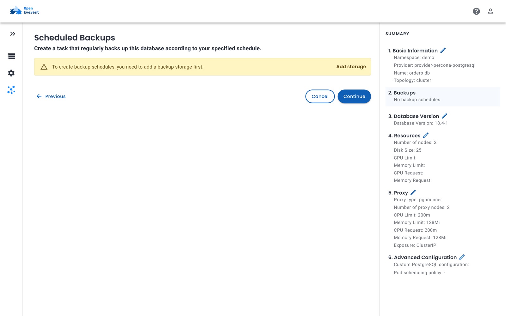

# Create backups

You need a [backup storage](backup_storage.md) in the instance's namespace and a provider that supports backups.

## Take a backup now

1. Open the instance and go to the **Backups** tab.
2. Click **Create backup**.
3. Enter a **Backup name**, and select the **Backup storage** and the **Backup class**. The backup class is pre-selected when the provider has only one.
4. Click **Create**.

The backup appears in the list with its **Status**, **Storage**, **Started** and **Finished** times and **Size**. It is usable for restores once its status is **Succeeded**.

## Schedule backups

You can add schedules when you create an instance — in the **Backups** step — or later on the instance's **Backups** tab.



1. Click **Create backup schedule**.
2. Enter a name for the schedule and select the **Backup storage**.
3. Set when the backup runs, for example every day at 02:00.
4. Set **Retention copies** — the number of backups of this schedule to keep. `0` keeps all of them.
5. Click **Create**.

An instance can have several schedules, for example hourly backups kept for a day and daily backups kept for a month, each writing to a different storage.

### Time-based retention

Instead of keeping a number of backups, you can keep backups for a period, such as 30 days. Time-based retention is set with `kubectl` and is supported only by providers whose engine supports it — for example PostgreSQL. Providers that don't support it report this in the instance's `BackupConfigured` condition.

```yaml
retention:
  type: time
  duration: 30d   # days (d), weeks (w) or months (m)
```

## Configure backups with kubectl

Backups are configured in the `spec.backup` section of the instance. Each storage entry can have its own schedules and point-in-time recovery settings:

```yaml
apiVersion: core.openeverest.io/v1alpha1
kind: Instance
metadata:
  name: orders-db
  namespace: demo
spec:
  providerRef:
    name: provider-percona-postgresql
  backup:
    enabled: true
    classRef:
      name: pg                 # kubectl get backupclasses
    storages:
      - storageRef:
          name: s3-backups
        schedules:
          - name: daily
            enabled: true
            cron: "0 2 * * *"
            retention:
              type: count
              count: 7
        pitr:
          enabled: true
```

To take a backup on demand, create a `Backup`:

```yaml
apiVersion: backup.openeverest.io/v1alpha1
kind: Backup
metadata:
  name: orders-db-before-migration
  namespace: demo
spec:
  origin:
    type: Instance
    instanceRef:
      name: orders-db
  classRef:
    name: pg
  storageRef:
    name: s3-backups
```

```sh
kubectl get backups -n demo
```

Some backup classes accept extra parameters in `spec.parameters`, for example the backup type (`full`, `diff` or `incr` for PostgreSQL). Check them with `kubectl get backupclass pg -o yaml`.

## Delete a backup

On the **Backups** tab, open the menu of a backup and select **Delete**. Select **Delete backups storage data** to also remove the backup's files from the bucket; otherwise, they stay in the bucket.

With `kubectl`, the same choice is the backup's `spec.deletionPolicy`: `Delete` (default) removes the data, `Retain` keeps it.
