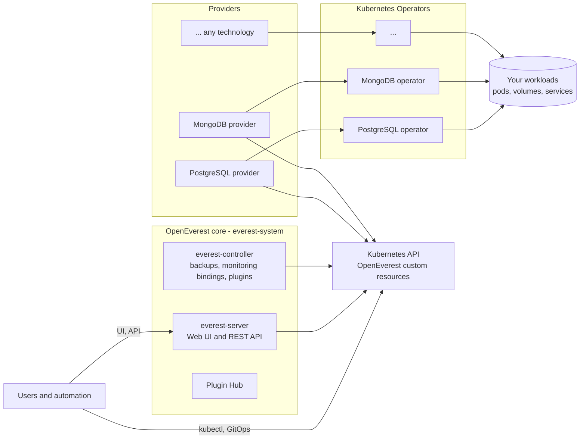
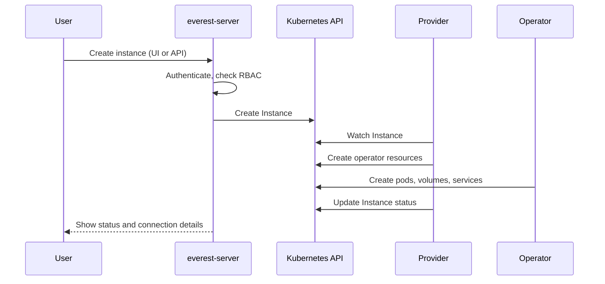
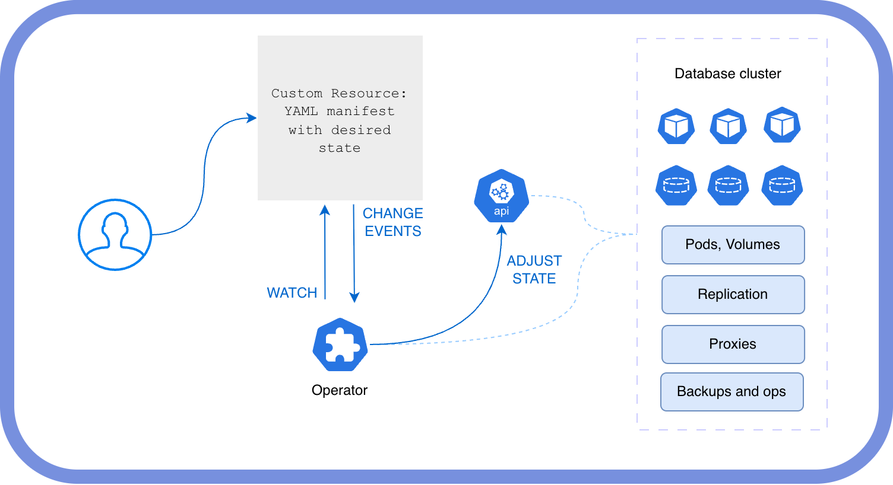

# Architecture

OpenEverest is built around a deliberately small core. The core knows how to store, secure and present your data workloads, but it does not know how to run any particular technology. That knowledge lives in **Providers**, which you install next to the core — one per technology. **Monitoring extensions** connect instances to monitoring systems, and **generic plugins** add features that are not tied to a technology. The core installs no database operator and no monitoring stack of its own.

Because of this split, new technologies and features are added, upgraded and released on their own schedule, without forking or rebuilding OpenEverest.

## Components

### OpenEverest core

The core is installed with one Helm chart into the `everest-system` namespace:

- **everest-server** serves the web UI and the [REST API](../API.md). It authenticates users, enforces [role-based access control](../administer/rbac.md), and reads and writes OpenEverest custom resources on the user's behalf.
- **everest-controller** runs the technology-agnostic controllers: backup storages, backups, restores and backup imports, monitoring bindings, and plugin registration.
- **Plugin Hub** is a generic plugin bundled with the chart. It shows the catalog of available providers and plugins inside the UI. See [Plugin Hub](../extend/hub.md).

The UI is a shell. The creation and edit forms for each technology are generated from a schema that the provider ships, and plugins can add their own pages and tabs. When you install a new provider or plugin, its screens appear without any change to the core.

### Providers

A [Provider](../extend/providers.md) teaches OpenEverest how to run one technology. It is a small controller, installed with its own Helm chart, that:

- registers a cluster-wide `Provider` resource describing the technology: its versions, topologies, components and the UI schema for its forms;
- reconciles every `Instance` that references it, usually by creating the custom resources of an upstream Kubernetes Operator;
- reports the instance status, connection details and backup state back to the core.

Most provider charts install the Operator they drive, so installing a provider is all you need to start creating instances of that technology.

### Monitoring extensions

A [monitoring extension](../extend/monitoring-extensions.md) adds one monitoring technology, such as PMM or Prometheus. It installs a `MonitoringClass` and a controller that checks the monitoring servers you register as `MonitoringDestination`s. Depending on the class, either the provider configures its Operator's native monitoring agent, or the extension configures the collection itself from the metrics endpoints the provider publishes. See [Monitoring](../use/monitoring.md).

### Generic plugins

A [generic plugin](../extend/generic-plugins.md) adds functionality on top of the core: UI pages, sidebar entries, instance tabs, and an optional backend that the core proxies with authentication and RBAC. Typical examples are metrics dashboards, troubleshooting tools and benchmarks.

## Everything is a Kubernetes resource

All OpenEverest state is stored in Kubernetes custom resources — there is no separate database. The UI and API are one way to manage them; `kubectl`, Helm or a GitOps tool such as Argo CD or Flux are equally valid. The main resources are:

| Resource | What it represents |
| --- | --- |
| `Provider` | An installed technology and what it supports. |
| `Instance` | A running deployment of a technology, for example a PostgreSQL cluster or a Valkey cache. |
| `BackupStorage`, `BackupClass`, `Backup`, `Restore` | Where and how backups are stored, taken and restored. |
| `InstancePreset`, `ClusterInstancePreset` | Reusable starting configurations for instances. |
| `MonitoringClass`, `MonitoringDestination`, `MonitoringBinding` | Monitoring technologies, the monitoring servers instances send to, and the links between them. |
| `Plugin` | A registered generic plugin. |

See [Key concepts](key-concepts.md) and [Custom resources](../crd/crd_guide.md).

## How an instance is created

## Why Kubernetes Operators

Providers build on Kubernetes Operators as the building block for stateful workloads.

An Operator is a Kubernetes extension that encodes the operational knowledge a human expert would use to deploy, configure, scale and recover a specific technology. Unlike Helm charts, which focus on the initial deployment, Operators keep managing the workload for its whole life:

- **Scaling**, horizontal and vertical, with coordination across members.
- **Backups and restores**, scheduled or on demand, often with point-in-time recovery.
- **Maintenance**, such as rolling restarts and version upgrades.
- **Self-healing** after pod failures and configuration drift.

A provider wraps an Operator and exposes it through OpenEverest's consistent API, UI and access control, so you get the Operator's expertise without learning a different interface for every technology.
