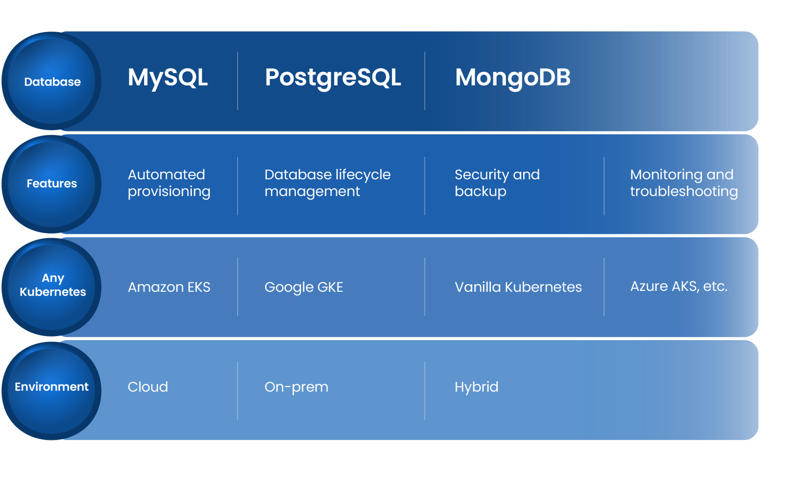

# Welcome to OpenEverest

We are excited to welcome you to OpenEverest, designed to demonstrate the core capabilities of our new open source cloud-native database platform!

## Why OpenEverest?

OpenEverest is the first open-source platform for automated database provisioning and management. It supports multiple database technologies and can be hosted on any Kubernetes infrastructure, in the cloud or on-premises.

  
## Ready to test drive OpenEverest?

Let's start by enabling you to deploy an automated private DBaaS, eliminating vendor lock-in and complex in-house platform development. 

[OpenEverest quickstart guide →](quick-install.md)  [Manage your first cluster →](use/db_provision.md)

Refer to our documentation, and you'll be set up in no time.

### 🔭 Discover 

Discover how OpenEverest simplifies and streamlines your database management and provisioning.

[Discover OpenEverest →](features.md)

### 🔒 Secure 

Explore how our security features are designed to ensure the security of your hosted databases.

[Secure your deployments →](security/sso_idp_integration.md)

### ❓ Troubleshooting 

Dive into our troubleshooting section designed to guide you through common issues you may encounter while using OpenEverest.

[Troubleshoot →](troubleshoot/troubleshoot.md)

### 🔌 OpenEverest API 

Get ready to dive into our APIs and uncover their potential.

[Dive into our APIs →](https://openeverest.io/docs/api/)

