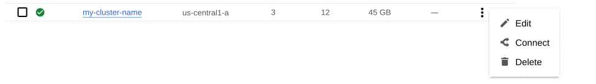

# Create Kubernetes cluster on Google Kubernetes Engine (GKE)

This guide will walk you through creating a Kubernetes cluster on Google Kubernetes Engine (GKE).

All commands from this guide can be run either in the **Google Cloud shell** or **your local shell**.

## Prerequisites

- A Google Cloud account with billing enabled.
- Basic understanding of Kubernetes concepts.

## Environment Setup

### Google Cloud Shell

To use _Google Cloud shell_, you need only a modern web browser. Open the [Google Cloud Console](https://console.cloud.google.com/) and click on the Cloud Shell icon at the top-right corner.


### Local Shell

If you would like to use _your local shell_, install the following:

1. [gcloud](https://cloud.google.com/sdk/docs/quickstarts). This tool is
   part of the Google Cloud SDK. To install it, select your operating
   system on the [official Google Cloud SDK documentation page](https://cloud.google.com/sdk/docs)
   and then follow the instructions.

2. [kubectl](https://cloud.google.com/kubernetes-engine/docs/quickstart#choosing_a_shell).
   It is the Kubernetes command-line tool you will use to manage and deploy
   applications. To install the tool, run the following command:

   ```bash
   $ gcloud auth login
   $ gcloud components install kubectl
   ```

## Create and configure the GKE cluster

You can configure the settings using the `gcloud` tool. You can run it either in
the [Cloud Shell](https://cloud.google.com/shell/docs/quickstart) or in your
local shell (if you have installed Google Cloud SDK locally on the previous
step).

### Step 1: Create the Cluster

The following command will create a cluster named `my-cluster-name`:

```bash
$ gcloud container clusters create my-cluster-name --project <project ID> --zone us-central1-a --cluster-version 1.33 --machine-type n1-standard-4 --num-nodes=3
```

:::note

- Replace &lt;project ID&gt; with your actual Google Cloud project ID (see available projects with `gcloud projects list` command).
- You may also need to edit the zone location, which is set to us-central1-a in the example above.

:::

This command creates a cluster with 3 nodes, each with a machine type of n1-standard-4 (4 vCPUs). The creation process may take a few minutes.

You may wait a few minutes for the cluster to be generated.

<details open>
<summary>When the process is over, you can see it listed in the Google Cloud console</summary>

Select *Kubernetes Engine* → *Clusters* in the left menu panel:



</details>

### Step 2: Configure Command-Line Access

Now you should configure the command-line access to your newly created cluster
to make `kubectl` be able to use it.

In the Google Cloud Console, select your cluster and then click the _Connect_
shown on the above image. You will see the connect statement which configures
the command-line access. You need to run the
command in your local shell:

```bash
$ gcloud container clusters get-credentials my-cluster-name --zone us-central1-a --project <project name>
```

### Step 3: Set Up Cluster Role Binding

Finally, use your [Cloud Identity and Access Management (Cloud IAM)](https://cloud.google.com/iam)
to control access to the cluster. The following command will give you the
ability to create Roles and RoleBindings:

```sh
kubectl create clusterrolebinding cluster-admin-binding --clusterrole cluster-admin --user $(gcloud config get-value core/account)
```

<details>
<summary>Expected output</summary>

```text
clusterrolebinding.rbac.authorization.k8s.io/cluster-admin-binding created
```

</details>

Congratulations! You have successfully created and configured a Kubernetes cluster on Google Kubernetes Engine (GKE).

## Remove the GKE cluster

Once you are done with your cluster, cleaning up the resources is a good practice to avoid unnecessary charges
You can clean up the cluster with the `gcloud` command as follows:

```bash
$ gcloud container clusters delete <cluster name> --zone us-central1-a --project <project ID>

```

This command will prompt you to confirm the deletion. Type `y` to confirm.

<details>
<summary>Also, you can delete your cluster via the Google Cloud console</summary>

Just click the `Delete` popup menu item in the clusters list:


</details>

The cluster deletion may take time.

:::warning

After deleting the cluster, all data stored in it will be lost!

:::

## Next Steps

Now that your Kubernetes cluster is running, you might want to deploy **OpenEverest**. Follow our quick install guide to get started quickly and easily.

<span className="oe-button">[Quick install →](../quick-install.md)</span>
