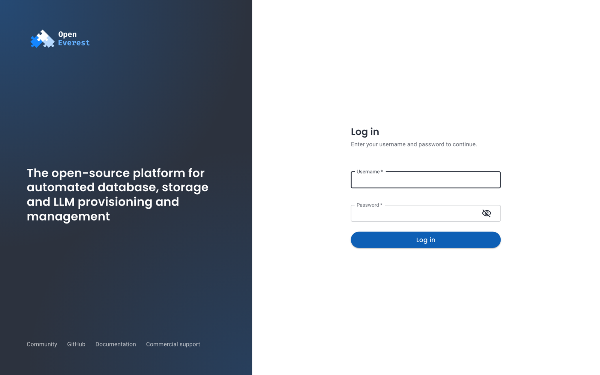
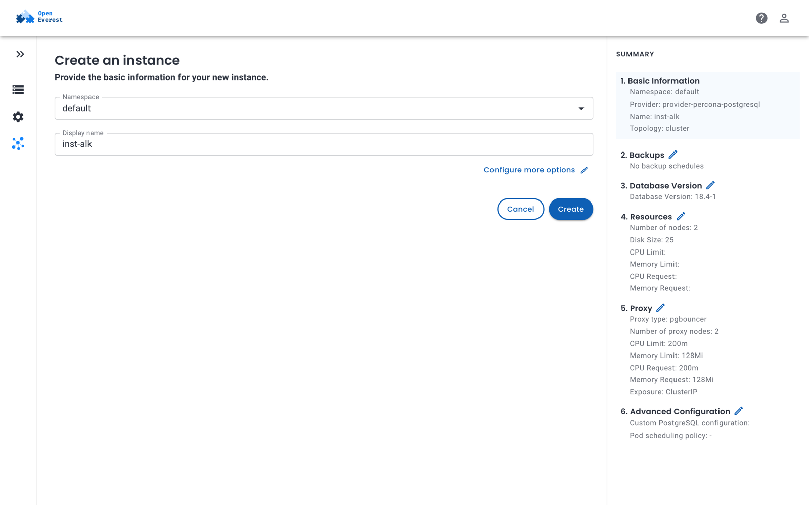

import Tabs from '@theme/Tabs';
import TabItem from '@theme/TabItem';

# Quickstart

This guide creates a local Kubernetes cluster, installs OpenEverest and a provider, and creates your first instance. It takes about fifteen minutes.

:::warning[Developer Preview]

OpenEverest 2 is a Developer Preview and is not intended for production. Install it on a fresh cluster: there is no upgrade path from OpenEverest 1.x yet, and running 1.x and 2 in the same cluster is not supported.

:::

## Before you start

You need:

- [Docker](https://docs.docker.com/get-docker/) with at least 8 GB of memory available, and [k3d](https://k3d.io/#installation) 5 or later. To use a cluster you already have instead, see [Prerequisites](install/prerequisites.md).
- [`kubectl`](https://kubernetes.io/docs/tasks/tools/).
- [Helm](https://helm.sh/docs/intro/install/) 3.

## 1. Create a cluster

<Tabs>
<TabItem value="k3d" label="Local cluster (k3d)">

Create a cluster with three nodes, so that instances with three members can spread across them:

```sh
k3d cluster create openeverest \
  --agents 2 \
  --image rancher/k3s:v1.37.1-k3s1
```

k3d points `kubectl` at the new cluster. Check that the nodes are ready:

```sh
kubectl get nodes
```

```text
NAME                       STATUS   ROLES           AGE   VERSION
k3d-openeverest-agent-0    Ready    <none>          10s   v1.37.1+k3s1
k3d-openeverest-agent-1    Ready    <none>          9s    v1.37.1+k3s1
k3d-openeverest-server-0   Ready    control-plane   13s   v1.37.1+k3s1
```

</TabItem>
<TabItem value="existing" label="Existing cluster">

Any cluster with Kubernetes 1.32 or later and a default StorageClass works, in any cloud or on-premises. See [Prerequisites](install/prerequisites.md) for what it needs.

Check that `kubectl` points at it:

```sh
kubectl get nodes
```

</TabItem>
</Tabs>

## 2. Install OpenEverest

Add the OpenEverest Helm repository and install the core into the `everest-system` namespace:

```sh
helm repo add openeverest https://openeverest.github.io/helm-charts/
helm repo update
helm install everest-core openeverest/openeverest \
  --version 2.0.0-dev.4 \
  --namespace everest-system \
  --create-namespace
```

Wait until the pods are running:

```sh
kubectl get pods -n everest-system
```

```text
NAME                                      READY   STATUS    RESTARTS   AGE
everest-controller-5474b99686-mw5c9       1/1     Running   0          40s
everest-core-plugin-hub-566d44f99-k7554   1/1     Running   0          40s
everest-server-7b6db64b79-728z8           1/1     Running   0          40s
```

## 3. Add a provider

The core does not run any technology by itself. Install at least one [provider](extend/providers.md) into the same namespace. This guide uses the PostgreSQL provider:

```sh
helm install provider-percona-postgresql \
  oci://ghcr.io/openeverest/charts/provider-percona-postgresql \
  --version 0.5.1 \
  --namespace everest-system
```

The provider chart also installs the Kubernetes Operator it drives. Check that the provider is registered:

```sh
kubectl get providers
```

```text
NAME                          AGE
provider-percona-postgresql   90s
```

:::note[Provider versions]

Providers are released separately from OpenEverest, and a provider is built for a specific OpenEverest version. The versions in this guide are tested together. Newer provider releases may need a newer OpenEverest; check the provider's release notes before you change the version.

:::

To use other technologies, find their providers in the **Plugin Hub** inside OpenEverest. See [Add providers](install/install_providers.md).

## 4. Log in

1. Get the password of the `admin` user:

    ```sh
    kubectl get secret everest-accounts -n everest-system \
      -o jsonpath='{.data.users\.yaml}' | base64 --decode | yq '.admin.passwordHash'
    ```

    To choose the password yourself, add `--set server.initialAdminPassword=<password>` to the `helm install` command in step 2. Either way, [change it](administer/manage_users.md) after you log in.

2. Forward the OpenEverest service to your machine:

    ```sh
    kubectl port-forward svc/everest 8080:8080 -n everest-system
    ```

3. Open [http://localhost:8080](http://localhost:8080) and log in as `admin`.

To expose OpenEverest permanently with a load balancer or an Ingress, see [Install OpenEverest](install/install_everest_helm_charts.md#expose-openeverest).

## 5. Create your first instance

Instances live in namespaces of your choice. Create one for this guide:

```sh
kubectl create namespace demo
```

1. On the **Instances** page, click the provider you installed.

    

2. Select the `demo` namespace and enter a display name. The summary on the right shows the defaults the provider will use.

    

3. Click **Create**.

The instance appears in the list with the status **Initializing** and becomes **Ready** when all its components are running — on a local cluster, after two to three minutes. You can follow the same progress with `kubectl`:

```sh
kubectl get instances -n demo
```

```text
NAME        PROVIDER                      VERSION   PHASE   AGE
orders-db   provider-percona-postgresql   18.4-1    Ready   2m44s
```

## Clean up

To remove everything, delete the cluster:

```sh
k3d cluster delete openeverest
```

On an existing cluster, see [Uninstall](uninstall/uninstall_everest_helm.md).

## Next steps

- [Connect to the instance](use/connect.md).
- [Set up backup storage and schedule backups](backups_and_restore/AboutBackups.md).
- [Add users and configure access control](administer/rbac.md).

<span className="oe-button">[Create an instance with custom options →](use/create_instance.md)</span>
