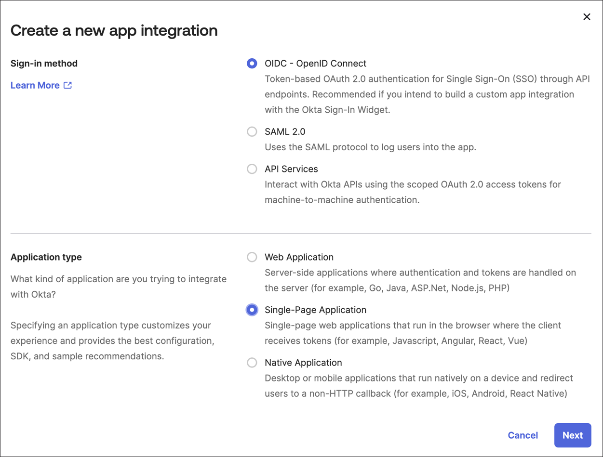
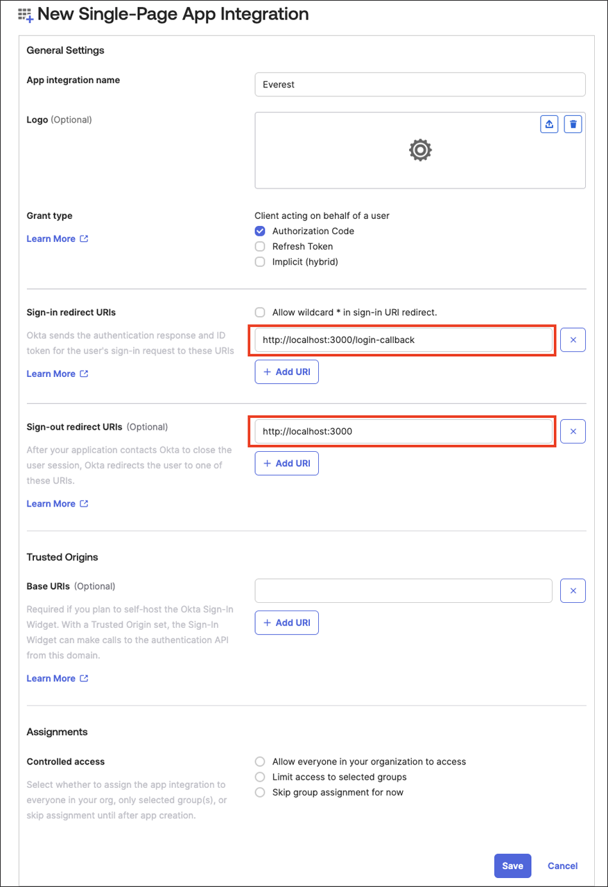
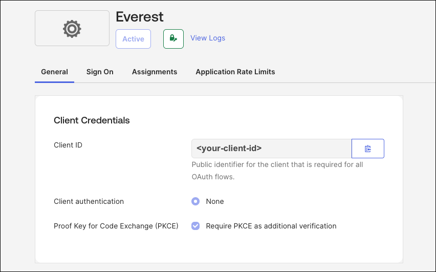
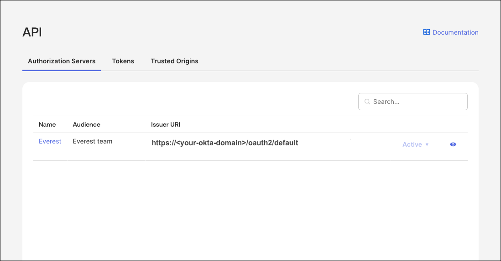
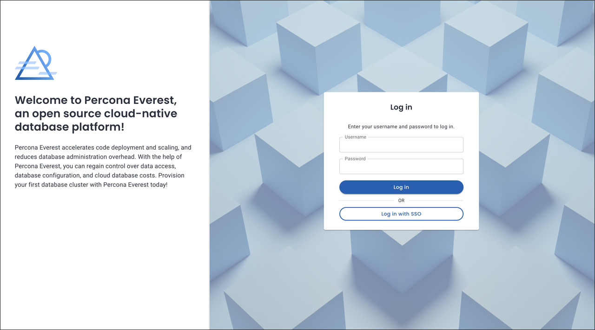

# Single sign-on (OIDC)

[Identity Provider (IdP)](https://www.okta.com/identity-101/why-your-company-needs-an-identity-provider/) integration connects applications and services with an external identity provider for your organization. This enables centralized authentication and authorization management, improving security and simplifying user access. By leveraging IdP integration, you can ensure that users are securely authenticated and authorized to access various applications and services across your organization.

OpenEverest uses [OpenID Connect](https://auth0.com/docs/authenticate/protocols/openid-connect-protocol) (OIDC) Protocol to integrate with external Identity Providers (IdP).

:::note[Note]

To integrate an IdP with OpenEverest, [configure OIDC on the IdP's side](#configure-oidc-on-the-provider-side), then [configure OpenEverest](#configure-openeverest).

:::

## Configure OIDC on the provider side

- **Proof Key for Code Exchange (PKCE)**: When setting up the Provider side, it's important to configure an application specifically for [PKCE](https://auth0.com/docs/get-started/authentication-and-authorization-flow#authorization-code-flow-with-proof-key-for-code-exchange-pkce-) authorization.

- **Redirect URIs**: 

    * Sign-in redirect URIs should point to `<EVEREST_URL>/login-callback`.
    * Sign-out redirect URIs should point to `<EVEREST_URL>`.
 
        :::info[Important]

        IdP providers often require a secure connection (HTTPS). Therefore, the provider might require your `<EVEREST_URL>` to be based on HTTPS. If your provider requires this, consider adding a reverse proxy in front of OpenEverest to provide such functionality.

        :::

- **Refresh tokens**: Allow the refresh token grant for the application, so that OpenEverest can keep users signed in. See [Keep SSO users signed in](#keep-sso-users-signed-in).

- **ID token**: OpenEverest reads the user from the ID token, so the IdP must sign it with an asymmetric key (for example RS256 or ES256), and put the `groups` claim in it if you use [group-based RBAC](../administer/Idp_groups_integration.md). See [How sign-in works](#how-sign-in-works).

### Example: OIDC configuration on the provider side

Below is an example of the configuration for the IdP provider Okta. 

Other popular IdPs include Microsoft Azure Active Directory, Auth0, Google Identity Platform, etc.

<details>
<summary>OKTA</summary>

1. Sign in to your Okta organization as a user with administrative privileges.

2. In the **Admin** Console, go to **Applications → Applications** and click **Create App Integration**.

3. On the **Create a new app integration page**, set the following:

    - Sign-in method - **OIDC - OpenID Connect**
    - **Application type** - **Single-Page Application**, and click **Next**.

    

4. Set the following fields:

    a. App integration name - any value

    b. Sign-in redirect URIs - `<EVEREST_URL>/login-callback`

    c. Sign-out redirect URIs - `<EVEREST_URL>`

    d. Grant type - select **Refresh Token** in addition to **Authorization Code**.

    :::note[Note]

    Okta allows the use of HTTP for development purposes and in cases where the Admin explicitly permits it.

    :::

    

    e. Click **Save**.

    f. Copy the `clientID` of the created app.

    

    g. Navigate to **Security → API → Authorization Servers** and copy the `issuerURL` you’d like to use for the Everest authorization. 

    

    :::note

    The values shown are for demonstration purposes only. Replace them with your **actual Okta configuration**.

    :::

</details>

## Configure OpenEverest

OpenEverest needs the **issuer URL** of your IdP and the **client ID** of the application you created. Optionally, set the **scopes** to request; the default is `openid`, `profile` and `email`.

The configuration is stored in the `everest-settings` ConfigMap in the `everest-system` namespace. Use one of the following methods.

### At installation, with Helm

```sh
helm install everest-core openeverest/openeverest \
  --version 2.0.0-alpha.1 \
  --namespace everest-system \
  --create-namespace \
  --set server.oidc.issuerUrl=https://example.okta.com \
  --set server.oidc.clientId=<client-id>
```

Helm writes `everest-settings` only on installation. To change the configuration later, use one of the other methods.

### After installation, with kubectl

1. Edit the ConfigMap:

    ```sh
    kubectl edit configmap everest-settings -n everest-system
    ```

    ```yaml
    data:
      oidc.config: |
        issuerUrl: https://example.okta.com
        clientId: <client-id>
        scopes:
          - openid
          - profile
          - email
    ```

2. Restart the server to apply the change:

    ```sh
    kubectl rollout restart deployment/everest-server -n everest-system
    ```

### After installation, with everestctl

```sh
everestctl settings oidc configure \
  --issuer-url=https://example.okta.com \
  --client-id=<client-id>
```

The command updates `everest-settings` and restarts the server for you. See [Users](../administer/manage_users.md#manage-built-in-users-with-everestctl) for how to get `everestctl` for OpenEverest 2.

:::note

- Restarting the server affects only the OpenEverest UI and API. Instances keep running.
- The restart breaks existing `kubectl port-forward` sessions. Start them again.

:::

## Testing IdP integration

After setting up your OIDC configuration, you can verify the functionality by visiting the OpenEverest login page and attempting to log in using Single Sign-On (SSO).



If OpenEverest can't use the OIDC configuration, for example because `clientId` is missing, it turns SSO off and the `everest-server` log says why. The server keeps running, so built-in users can still log in.

## How sign-in works

1. The UI signs the user in with the IdP, using the authorization code flow with PKCE.
2. The UI sends the **ID token** it received to OpenEverest, which exchanges it for an OpenEverest access token. The exchange is an [RFC 8693](https://www.rfc-editor.org/rfc/rfc8693) token-exchange grant on `POST /v1/auth/token`; see [API](../API.md#single-sign-on-users).
3. The UI calls the API with the OpenEverest access token. The API accepts only tokens that OpenEverest issued; IdP tokens are refused.

OpenEverest accepts an ID token only if:

- it is signed with an asymmetric key from the IdP's published keys (JWKS). Tokens signed with a shared secret (`HS256`) are refused — in Authentik, for example, give the provider a signing key;
- its issuer (`iss`) equals the configured issuer URL;
- its audience (`aud`) contains the configured client ID, and its authorized party (`azp`), when present, is the client ID;
- it was issued in the last 5 minutes and has not expired.

Access tokens and the UserInfo endpoint are not used, because they don't prove which application they were issued to. IdPs that give the browser opaque access tokens, such as Auth0 and Authentik, work, because they still issue a JWT ID token.

The user's groups are read from the `groups` claim of the **ID token** only. Groups that the IdP puts only in the access token or in UserInfo are not seen. In Keycloak, for example, enable **Add to ID token** on the group mapper.

## Keep SSO users signed in

An SSO session in OpenEverest lasts 15 minutes, the lifetime of the OpenEverest access token. When it expires, the OpenEverest UI renews it with your IdP in the background, without prompting the user, and exchanges the new ID token again. To do that, the UI needs a refresh token from the IdP. Without one, SSO users are signed out every 15 minutes.

To get a refresh token:

1. Allow the refresh token grant for the OpenEverest application in your IdP, for example **Refresh Token** in the grant types of the application in Okta or ZITADEL. Keycloak issues refresh tokens by default.

2. Add the `offline_access` scope to the OIDC configuration of OpenEverest, together with the other scopes you need:

    ```sh
    everestctl settings oidc configure \
    --issuer-url=<your-issuer-url> \
    --client-id=<your-app-client-id> \
    --scopes=openid,profile,email,offline_access
    ```

    Like any change to the OIDC configuration, this restarts the OpenEverest server. Users get a refresh token the next time they sign in.

Each renewal exchanges a new ID token, so the IdP must include an `id_token` in its refresh token response. Keycloak, Auth0, Microsoft Entra ID, Okta and Google do when the `openid` scope was granted.

OpenEverest issues no refresh token of its own to SSO users, so the IdP stays in control: a user disabled in the IdP loses access when their OpenEverest access token expires, at most about 20 minutes later.

## OpenEverest OIDC configuration for Microsoft Entra

Use the v2.0 issuer URL of your tenant. OpenEverest compares the issuer of every ID token with it, so the multi-tenant endpoints (`common`, `organizations` and `consumers`) don't work.

```sh
everestctl settings oidc configure \
--issuer-url=https://login.microsoftonline.com/<tenant-id>/v2.0 \
--client-id=<your-app-client-id>
```

:::note

Replace `<tenant-id>` with your directory (tenant) ID and `<your-app-client-id>` with your application (client) ID. The default scopes (`openid`, `profile` and `email`) are enough: OpenEverest validates the ID token, whose audience is your application, so the `<your-app-client-id>/.default` scope that older OpenEverest versions needed is not required.

:::

To use group-based RBAC policies, add a groups claim to the app registration in **Token configuration** > **Add groups claim**. By default, Microsoft Entra lists groups by their object IDs, so use those IDs as group names in your RBAC policies.

For the limitations, see [OIDC integration with Microsoft Entra](../reference/known_limitations.md#oidc-integration-with-microsoft-entra).
