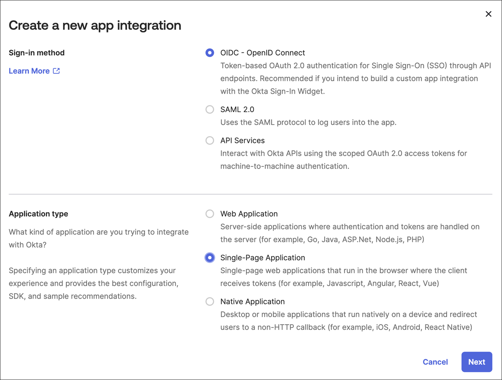
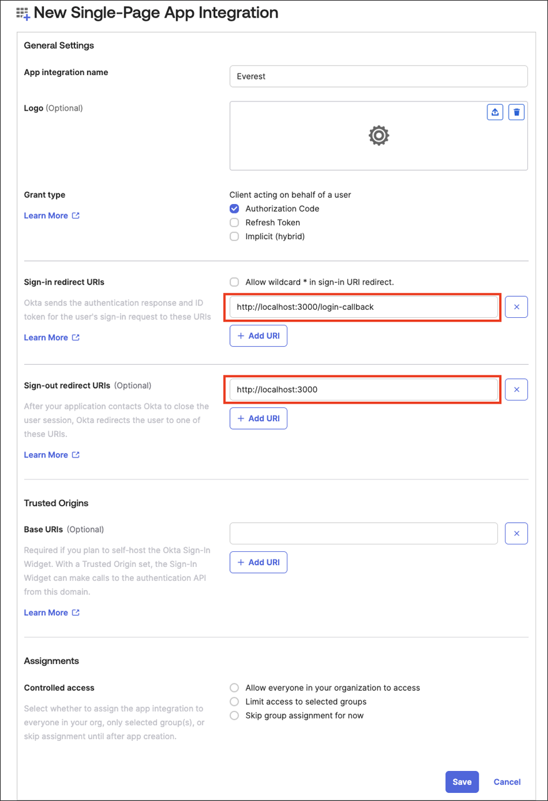
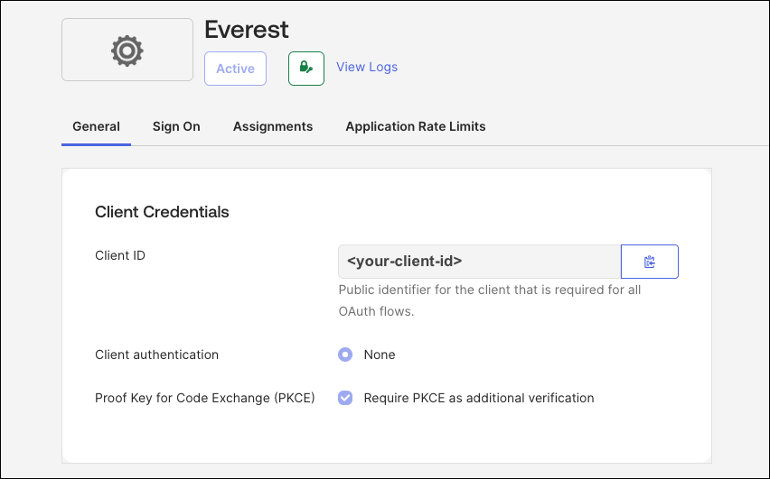
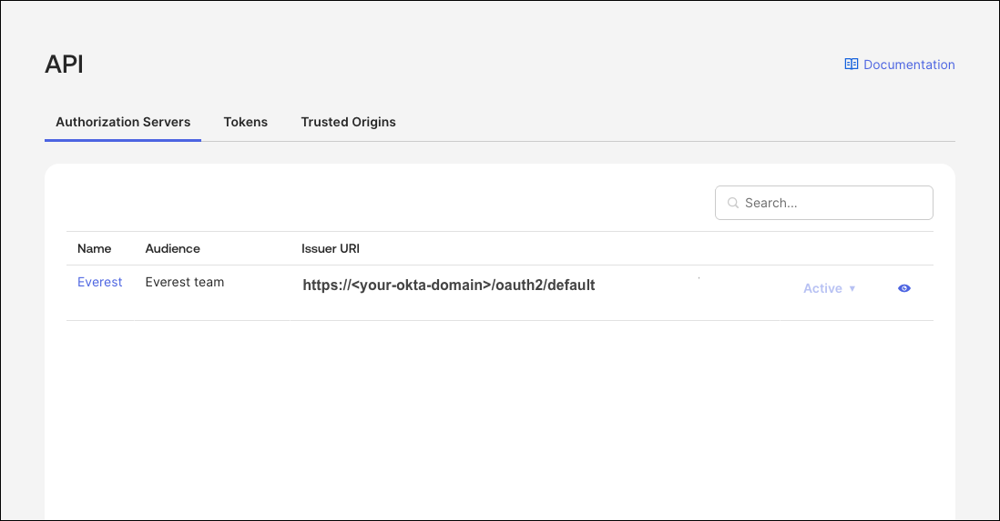
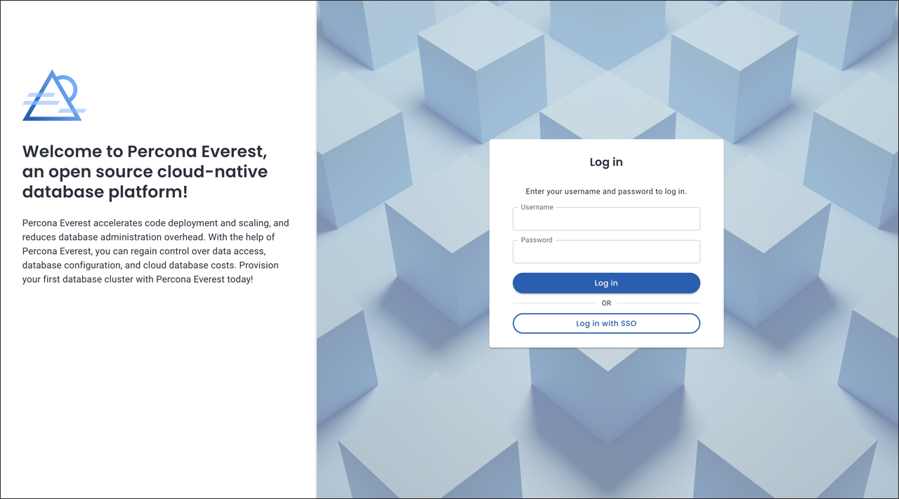

# SSO: OpenEverest IdP integration

[Identity Provider (IdP)](https://www.okta.com/identity-101/why-your-company-needs-an-identity-provider/) integration connects applications and services with an external identity provider for your organization. This enables centralized authentication and authorization management, improving security and simplifying user access. By leveraging IdP integration, you can ensure that users are securely authenticated and authorized to access various applications and services across your organization.

OpenEverest uses [OpenID Connect](https://auth0.com/docs/authenticate/protocols/openid-connect-protocol) (OIDC) Protocol to integrate with external Identity Providers (IdP).

:::note[Note]

To integrate IdP with OpenEverest, first, [install OpenEverest](../install/installEverest.md) and then [configure OIDC](#configure-oidc-on-the-provider-side) on the IdP's side as well as the [OpenEverest side](#configure-oidc-on-openeverest-side).

:::

## Configure OIDC on the provider side

- **Proof Key for Code Exchange (PKCE)**: When setting up the Provider side, it's important to configure an application specifically for [PKCE](https://auth0.com/docs/get-started/authentication-and-authorization-flow#authorization-code-flow-with-proof-key-for-code-exchange-pkce-) authorization.

- **Redirect URIs**: 

    * Sign-in redirect URIs should point to `<EVEREST_URL>/login-callback`.
    * Sign-out redirect URIs should point to `<EVEREST_URL>`.
 
        :::info[Important]

        IdP providers often require a secure connection (HTTPS). Therefore, the provider might require your `<EVEREST_URL>` to be based on HTTPS. If your provider requires this, consider adding a reverse proxy in front of OpenEverest to provide such functionality.

        :::

- **Refresh tokens**: Allow the refresh token grant for the application, so that OpenEverest can keep users signed in. See [Keep SSO users signed in](#keep-sso-users-signed-in).

### Example: OIDC configuration on the provider side

Below is an example of the configuration for the IdP provider Okta. 

Other popular IdPs include Microsoft Azure Active Directory, Auth0, Google Identity Platform, etc.

<details>
<summary>OKTA</summary>

1. Sign in to your Okta organization as a user with administrative privileges.

2. In the **Admin** Console, go to **Applications → Applications** and click **Create App Integration**.

3. On the **Create a new app integration page**, set the following:

    - Sign-in method - **OIDC - OpenID Connect**
    - **Application type** - **Single-Page Application**, and click **Next**.

    

4. Set the following fields:

    a. App integration name - any value

    b. Sign-in redirect URIs - `<EVEREST_URL>/login-callback`

    c. Sign-out redirect URIs - `<EVEREST_URL>`

    d. Grant type - select **Refresh Token** in addition to **Authorization Code**.

    :::note[Note]

    Okta allows the use of HTTP for development purposes and in cases where the Admin explicitly permits it.

    :::

    

    e. Click **Save**.

    f. Copy the `clientID` of the created app.

    

    g. Navigate to **Security → API → Authorization Servers** and copy the `issuerURL` you’d like to use for the Everest authorization. 

    

    :::note

    The values shown are for demonstration purposes only. Replace them with your **actual Okta configuration**.

    :::

</details>

## Configure OIDC on the OpenEverest's side

You can configure OIDC on the OpenEverest's side using `everestctl` in headless mode or with the wizard.

:::note[Note]

You must have obtained the `Issuer URL` and `Client ID` values from the [Configure OIDC on the provider side](#example-oidc-configuration-on-the-provider-side) section.

:::

To configure OIDC using the headless mode, run the following command:

```
everestctl settings oidc configure --issuer-url=http://url.com --client-id=<your-app-client-id
```

<details>
<summary>Output</summary>

```text
2024-06-18T11:06:18Z    info    oidc/configure.go:110   OIDC provider configured, restarting Everest..
2024-06-18T11:06:33Z    info    oidc/configure.go:117   OIDC has been configured successfully
```

</details>

To configure OIDC using the wizard, run the following command:

```
$ everestctl settings oidc configure
```

<details>
<summary>Output</summary>

```text
? Enter issuer URL <your-provider-url>
? Enter client ID <your-app-client-id>
2024-06-18T11:05:15Z    info    oidc/configure.go:110   OIDC provider   configured, restarting Everest..    
2024-06-18T11:05:30Z    info    oidc/configure.go:117   OIDC has been configured successfully
```

</details>

<details>
<summary>What's happening under the hood?</summary>

This command stores the updated configuration in k8s and restarts the Everest deployment.

1. **Store Configuration**

    The OIDC settings are stored in the `everest-settings` ConfigMap in the `everest-system` namespace, along with other settings, in the following format:

    ```sh
    apiVersion: v1
    kind: ConfigMap
    metadata:
        name: everest-settings
        namespace: everest-system
    data:
        data:
        oidc.config: |
            issuerUrl: <your OIDC provider URL>
            clientId: <your OIDC provider client ID>
    ```

    The Everest user should not directly interact with the `everest-settings` ConfigMap. Use the `everestctl` command to set up the OIDC config.

2. **Restart OpenEverest**

    OIDC configuration must be in place for OpenEverest to start the API Server, allowing the server to utilize the OIDC provider's validation. This means that after setting up the OIDC configuration, the OpenEverest API Server needs to be restarted.

    The `everestctl` command typically takes approximately 15 seconds to execute. It waits for the Everest Deployment to be up again before exiting successfully.

    :::info[Important]

    - The restart only impacts the Everest UI and API. Database clusters are not affected.

    - The restart results in the loss of the port-forwarding connection. If you had port-forwarding enabled on your machine to access OpenEverest UI and API, you will need to set it up again.

    :::

</details>

## Testing IdP integration

After setting up your OIDC configuration, you can verify the functionality by visiting the OpenEverest login page and attempting to log in using Single Sign-On (SSO).



## Keep SSO users signed in

An SSO session in OpenEverest lasts 15 minutes. When it expires, the OpenEverest UI renews it with your IdP in the background, without prompting the user. To do that, the UI needs a refresh token from the IdP. Without one, SSO users are signed out every 15 minutes, and the browser console shows a Content Security Policy error about framing your IdP, followed by `IFrame timed out without a response`.

To get a refresh token:

1. Allow the refresh token grant for the OpenEverest application in your IdP, for example **Refresh Token** in the grant types of the application in Okta or ZITADEL. Keycloak issues refresh tokens by default.

2. Add the `offline_access` scope to the OIDC configuration of OpenEverest, together with the other scopes you need:

    ```sh
    everestctl settings oidc configure \
    --issuer-url=<your-issuer-url> \
    --client-id=<your-app-client-id> \
    --scopes=openid,profile,email,offline_access
    ```

    Like any change to the OIDC configuration, this restarts OpenEverest. Users get a refresh token the next time they sign in.

From OpenEverest 1.17.1, each renewal exchanges a new ID token, so the IdP must include an `id_token` in its refresh token response. Most IdPs do when the `openid` scope was granted.

## OpenEverest OIDC configuration for Microsoft Entra

Use the v2.0 issuer URL of your tenant. OpenEverest compares the issuer of every ID token with it, so the multi-tenant endpoints (`common`, `organizations` and `consumers`) don't work.

```sh
everestctl settings oidc configure \
--issuer-url=https://login.microsoftonline.com/<tenant-id>/v2.0 \
--client-id=<your-app-client-id>
```

:::note

Replace `<tenant-id>` with your directory (tenant) ID and `<your-app-client-id>` with your application (client) ID. From OpenEverest 1.17.1, the default scopes (`openid`, `profile` and `email`) are enough. OpenEverest 1.17.0 and earlier also need the `<your-app-client-id>/.default` scope, see [OpenEverest 1.17.0 and earlier](../reference/known_limitations.md#openeverest-1170-and-earlier). After upgrading to 1.17.1, you can drop that scope by running the command again without `--scopes`.

:::

To use group-based RBAC policies, add a groups claim to the app registration in **Token configuration** > **Add groups claim**. By default, Microsoft Entra lists groups by their object IDs, so use those IDs as group names in your RBAC policies.

For the limitations, see [OIDC integration with Microsoft Entra](../reference/known_limitations.md#oidc-integration-with-microsoft-entra).
