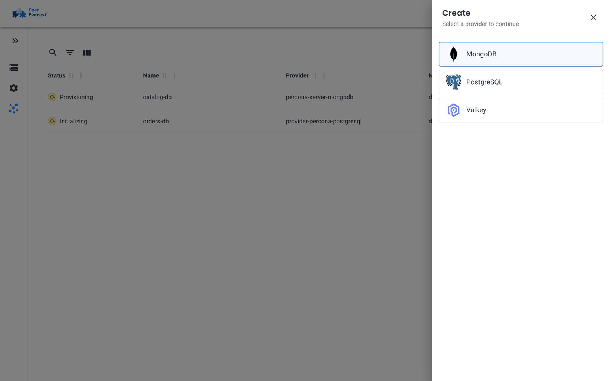
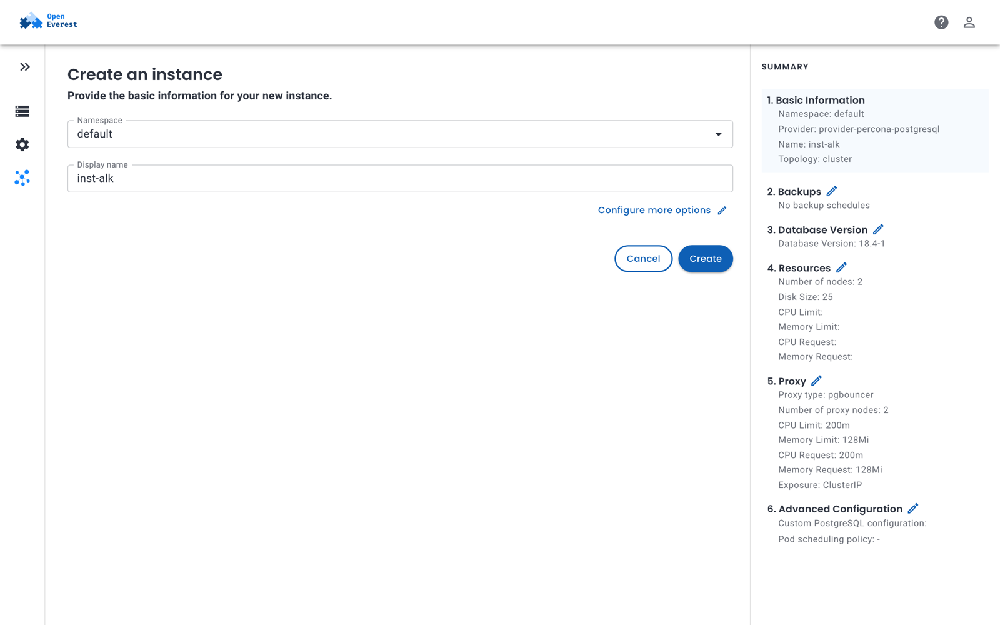
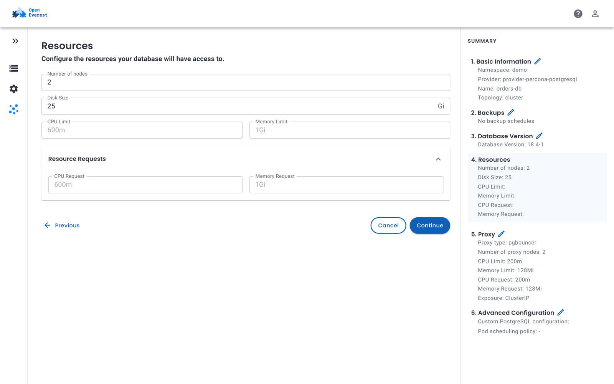
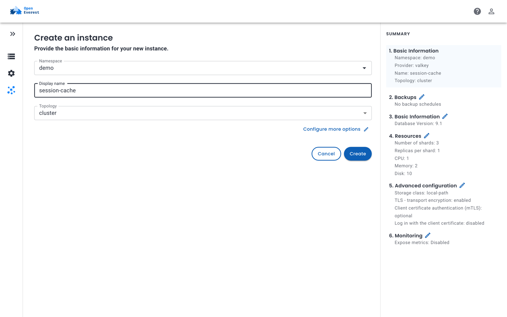

# Create an instance

You can create an instance with the provider's defaults in a few clicks, or go through every option the provider offers. You need at least one [provider](../install/install_providers.md) installed and a namespace to create the instance in — see [Namespaces](../administer/manage_namespaces.md).

## Create an instance in the UI

1. On the **Instances** page, click **Create** and select a provider. When no instances exist yet, click the provider's tile instead.

    

2. Fill in the basic information:

    - **Namespace** — where the instance and its resources are created.
    - **Display name** — the name of the instance. It must be unique in the namespace.
    - **Topology** — shown when the provider offers more than one, for example *replica set* or *sharded* for MongoDB.
    - **Preset** — shown when [instance presets](../administer/instance_presets.md) exist. A preset pre-fills the rest of the form.

    The **Summary** on the right shows the configuration the instance will get.

    

3. Click **Create** to use the defaults, or **Configure more options** to change them.

The instance appears on the **Instances** page with the status **Provisioning** or **Initializing** and becomes **Ready** when it is up.

## Configure more options

**Configure more options** walks you through the settings step by step. The steps and fields come from the provider, so they are different for each technology. You can jump to any step with the edit icons in the summary.

For example, the PostgreSQL provider has these steps:

| Step | What you configure |
| --- | --- |
| **Backups** | Backup schedules and point-in-time recovery. You need a [backup storage](../backups_and_restore/backup_storage.md) first. |
| **Database Version** | The engine version. |
| **Resources** | Number of nodes, disk size, CPU and memory limits and requests. |
| **Proxy** | The connection pooler: type, number of nodes, resources and how clients reach it (**Exposure**). |
| **Advanced Configuration** | Custom engine configuration parameters and the [pod scheduling policy](../administer/pod_scheduling.md) for each component. |



A Valkey instance, by contrast, asks for the number of shards and replicas per shard, TLS settings and whether to expose metrics.



Some sections are optional and have an **Enable** switch. While a section is off, its fields are not sent and the provider's defaults apply.

Click **Create** on the last step to create the instance.

## Create an instance with kubectl

An instance is an `Instance` custom resource, so you can also create it with `kubectl` or a GitOps tool. Only `providerRef` is required; the provider fills in its defaults for everything else.

```yaml title="orders-db.yaml"
apiVersion: core.openeverest.io/v1alpha1
kind: Instance
metadata:
  name: orders-db
  namespace: demo
spec:
  providerRef:
    name: provider-percona-postgresql
  topology:
    type: cluster
  components:
    engine:
      replicas: 3
      storage:
        size: 50Gi
```

```sh
kubectl apply -f orders-db.yaml
```

To find the topologies, components and versions a provider supports, look at its `Provider` resource:

```sh
kubectl get provider provider-percona-postgresql -o yaml
```

See [Instance](../crd/instance.md) for the full reference.

## Next steps

- [Connect to the instance](connect.md).
- [Set up backups](../backups_and_restore/create_backups.md).
