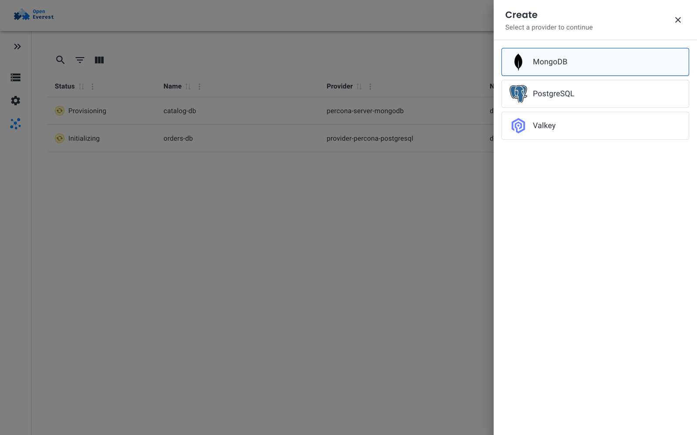

# Instances overview

An **instance** is one running deployment of a technology — a PostgreSQL cluster, a MongoDB replica set, a Valkey cache. Whatever the technology, you find, inspect and manage instances in the same place.

## The Instances page

**Instances** in the left menu lists every instance you have access to, across all namespaces. For each instance you see its **Status**, **Name**, **Provider** and **Namespace**, and an **Actions** menu.

- Use the search, filter and column icons above the table to narrow the list.
- **Create** opens a panel where you pick the provider for a new instance. See [Create an instance](create_instance.md).
- **Import database** creates an instance from a backup that already exists in a backup storage. See [Create an instance from a backup](../backups_and_restore/create_from_backup.md#import-a-backup-from-storage).



When no instance exists yet, the page shows the installed providers instead, so you can start right away.

## Instance status

The status column shows one status word. It is the same word in the UI, in `everestctl` and in `kubectl get instances`. Common ones:

| Status | Meaning |
| --- | --- |
| **Creating** | The instance has never been up yet. The provider is creating it. |
| **Ready** | The latest configuration is applied and every check passes. |
| **Applying changes** | A change, such as scaling or a configuration change, is being rolled out. |
| **Upgrading**, **Restoring**, **Resizing storage** | A long operation is running. |
| **Pods starting** | Pods are not ready yet. |
| **Pods can't be scheduled**, **Crash loop**, **Image can't be pulled** | Pods have a problem. |
| **Invalid configuration** | The provider rejected the instance's settings. The message names each invalid field. |
| **Secret not found**, **Backup storage not found** | An object the instance uses is missing. |
| **Provider not found**, **Provider not responding** | No provider is working on the instance. See [When no provider reconciles the instance](../crd/instance.md#when-no-provider-reconciles-the-instance). |
| **Deleting** | The instance is being deleted. |

The colour tells you whether to wait or act. Yellow means work is in progress, or a problem that may still clear by itself. Red means progress has stopped and someone has to act: either at once, for example after an invalid configuration, or after a problem has lasted 10 minutes.

While an instance that has been up before is changing, the status also says whether clients can connect, for example **Upgrading · available** or **Restoring · unavailable**.

When something needs attention, the instance page shows an alert with the reason and what to do, for example *"engine: 1 of 3 pods cannot be scheduled: 0/2 nodes are available: 2 node(s) didn't match pod anti-affinity rules."* While a restore, an upgrade or a storage resize runs, the instance can't be edited. See [Diagnostics](../troubleshoot/troubleshoot.md).

## Instance details

Click an instance to open its details. The page has these tabs:

- **Overview** — basic information, [connection details](connect.md), and cards with the instance's configuration, grouped as the provider defines them (for example *Resources*, *Proxy* or *Advanced configuration*). Cards that can be changed have an **Edit** button. See [Change and delete instances](manage_instances.md).
- **Backups** — the instance's backups and backup schedules, and point-in-time recovery. See [Create backups](../backups_and_restore/create_backups.md).
- **Restores** — the history and status of restores into this instance. See [Restore a backup](../backups_and_restore/restore.md).

[Generic plugins](../extend/generic-plugins.md) can add their own tabs and overview cards, for example to browse data or show metrics.

## Instances in Kubernetes

Every instance is an `Instance` custom resource. You can see the same information with `kubectl`:

```sh
kubectl get instances -A
```

```text
NAMESPACE   NAME            PROVIDER                      VERSION   AVAILABLE   STATUS             AGE
demo        catalog-db      percona-server-mongodb        8.0.32    False       Creating           14s
demo        orders-db       provider-percona-postgresql   18.4-1    True        ApplyingChanges    26m
demo        session-cache   valkey                        9.1       True        Ready              3d
```

`STATUS` is the reason of the `Ready` condition. `kubectl get` shows the reason as one word, for example `ApplyingChanges`, where the UI shows **Applying changes**. Add `-o wide` for the phase, whether the instance is stalled, and the message.

To wait until an instance is ready:

```sh
kubectl wait instance/orders-db -n demo --for=condition=Ready --timeout=10m
```

For the full status, including every condition and the number of ready pods per component:

```sh
kubectl get instance orders-db -n demo -o yaml
```

See [Instance](../crd/instance.md).
