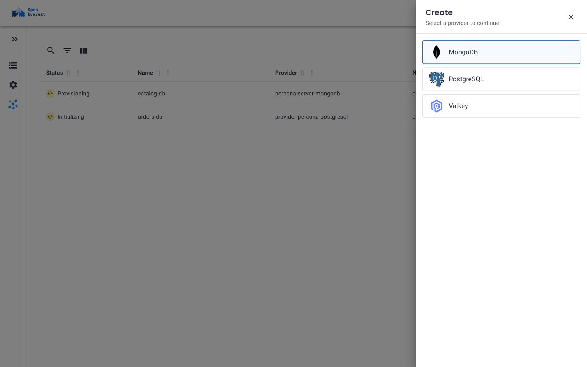

# Instances overview

An **instance** is one running deployment of a technology — a PostgreSQL cluster, a MongoDB replica set, a Valkey cache. Whatever the technology, you find, inspect and manage instances in the same place.

## The Instances page

**Instances** in the left menu lists every instance you have access to, across all namespaces. For each instance you see its **Status**, **Name**, **Provider** and **Namespace**, and an **Actions** menu.

- Use the search, filter and column icons above the table to narrow the list.
- **Create** opens a panel where you pick the provider for a new instance. See [Create an instance](create_instance.md).
- **Import database** creates an instance from a backup that already exists in a backup storage. See [Create an instance from a backup](../backups_and_restore/create_from_backup.md#import-a-backup-from-storage).



When no instance exists yet, the page shows the installed providers instead, so you can start right away.

## Instance status

The status column shows the phase of the instance:

| Status | Meaning |
| --- | --- |
| **Pending** | The instance was accepted but the provider has not started creating it. |
| **Provisioning** | The provider is creating the Kubernetes resources. |
| **Initializing** | The resources exist and the engine is starting for the first time. |
| **Ready** | The instance is healthy and accepts connections. |
| **Updating** | A change, such as scaling or a configuration change, is being rolled out. |
| **Restoring** | Data is being restored from a backup. |
| **Terminating** | The instance is being deleted. |
| **Failed** | The instance needs attention, for example because its pods keep crashing. |

If some pods can't be scheduled or are not ready, the instance shows a warning with the reason, for example *"engine: 1 of 3 pods cannot be scheduled: 0/2 nodes are available: 2 node(s) didn't match pod anti-affinity rules."* See [Diagnostics](../troubleshoot/troubleshoot.md).

## Instance details

Click an instance to open its details. The page has these tabs:

- **Overview** — basic information, [connection details](connect.md), and cards with the instance's configuration, grouped as the provider defines them (for example *Resources*, *Proxy* or *Advanced configuration*). Cards that can be changed have an **Edit** button. See [Change and delete instances](manage_instances.md).
- **Backups** — the instance's backups and backup schedules, and point-in-time recovery. See [Create backups](../backups_and_restore/create_backups.md).
- **Restores** — the history and status of restores into this instance. See [Restore a backup](../backups_and_restore/restore.md).

[Generic plugins](../extend/generic-plugins.md) can add their own tabs and overview cards, for example to browse data or show metrics.

## Instances in Kubernetes

Every instance is an `Instance` custom resource. You can see the same information with `kubectl`:

```sh
kubectl get instances -A
```

```text
NAMESPACE   NAME            PROVIDER                      VERSION   PHASE          READY   REASON         AGE
demo        catalog-db      percona-server-mongodb        8.0.32    Provisioning   False   Provisioning   14s
demo        orders-db       provider-percona-postgresql   18.4-1    Initializing   False   Initializing   83s
demo        session-cache   valkey                        9.1       Provisioning                          3s
```

For the full status, including the conditions and the number of ready pods per component:

```sh
kubectl get instance orders-db -n demo -o yaml
```

See [Instance](../crd/instance.md).
