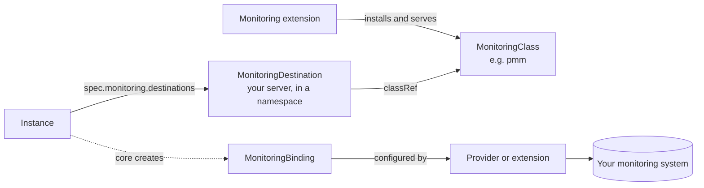

# Monitoring

OpenEverest installs no monitoring system, agents or metrics stack. Instead, it connects instances to the monitoring system you already run — PMM, Prometheus, VictoriaMetrics or another one — through **monitoring extensions**. What an instance can send, and to which systems, depends on its provider.

:::info[Work in progress]

Monitoring is being rebuilt as an extension point during the OpenEverest 2 Developer Preview. The API described on this page is available; UI support is still being added, so configure monitoring with `kubectl` for now. Names, fields and behavior may change before General Availability.

:::

## How it works



| Resource | Scope | Created by | What it is |
| --- | --- | --- | --- |
| `MonitoringClass` | Cluster | A monitoring extension | A monitoring technology, such as `pmm` or `prometheus`, and the settings and authentication methods its destinations accept. |
| `MonitoringDestination` | Namespace | You | One monitoring server: its address, credentials and TLS settings. Instances in the same namespace can send to it. |
| `Instance.spec.monitoring.destinations` | Instance | You | The destinations an instance sends to — up to 8 — with optional per-instance parameters. |
| `MonitoringBinding` | Namespace | OpenEverest | One per instance and destination. It records whether the link is accepted and configured. Read-only. |

A class is served in one of two ways:

- **Provider-managed.** The provider configures its Operator's native integration — for example, the Percona providers run the PMM agent next to the database. The monitoring extension only checks the destination.
- **Extension-managed.** The provider publishes the metrics endpoints of each component in the instance status, and the monitoring extension configures the collection — for example, by creating Prometheus Operator `PodMonitor` resources.

OpenEverest decides the mode per provider. `kubectl get monitoringclass <name> -o yaml` shows, under `status.providers`, which installed providers are compatible with the class, in which mode, and how disruptive enabling it is.

## Install a monitoring extension

Monitoring extensions are installed with Helm, like providers. Each extension's README describes its installation, chart values and prerequisites — for example [monitoring-pmm](https://github.com/openeverest/monitoring-pmm) for PMM 3 or [monitoring-prometheus](https://github.com/openeverest/monitoring-prometheus) for the Prometheus Operator.

Check that the class is installed and claimed by its controller:

```sh
kubectl get monitoringclasses
```

```text
NAME   ACCEPTED   AGE
pmm    Accepted   1m
```

## Example: send metrics to PMM

This example sends the metrics and Query Analytics of an instance to a PMM 3 server. It needs the PMM monitoring extension and a provider that supports PMM.

1. In PMM, create a service account with the **Admin** role and a token for it. The providers register database nodes with PMM using this token.

2. Store the token in a Secret in the instance's namespace, under the key `token`:

    ```sh
    kubectl create secret generic pmm-token -n demo --from-literal=token=glsa_...
    ```

3. Create the destination:

    ```yaml
    apiVersion: monitoring.openeverest.io/v1alpha1
    kind: MonitoringDestination
    metadata:
      name: pmm-prod
      namespace: demo
    spec:
      classRef:
        name: pmm
      parameters:
        url: https://pmm.example.com
      authentication:
        mode: ServiceAccountToken
        credentialsSecretRef:
          name: pmm-token
    ```

    For a server with a certificate from a private CA, add `tls.ca.secretKeyRef` pointing at the CA bundle.

4. Check that the destination is ready:

    ```sh
    kubectl get monitoringdestination pmm-prod -n demo
    ```

    ```text
    NAME       CLASS   AUTH                  ACCEPTED   READY   VERSION   AGE
    pmm-prod   pmm     ServiceAccountToken   Accepted   Ready   3.8.0     1m
    ```

5. Add the destination to the instance:

    ```yaml
    spec:
      monitoring:
        destinations:
          - name: pmm
            destinationRef:
              name: pmm-prod
    ```

    The `name` identifies the entry within the instance. Some classes accept per-instance settings in `parameters` — for PMM, the resources of the agent container.

:::note

Enabling or disabling monitoring may add or remove an agent or exporter container, which restarts the instance's pods one at a time. If the instance's [maintenance settings](../crd/instance.md#maintenance) do not allow rolling restarts, the change waits for approval and the binding reports `MaintenancePending`.

:::

To stop sending to a destination, remove its entry from the instance.

## Expose metrics without a destination

To collect an instance's metrics with a tool that OpenEverest does not configure — a Datadog agent, Grafana Alloy, a Prometheus you manage yourself — ask the provider to serve them without a destination:

```yaml
spec:
  monitoring:
    sources:
      metrics:
        policy: Always
```

With the default policy, `OnDemand`, the provider runs its metrics exporters only while a destination needs metrics. With `Always`, it runs them whether or not the instance has destinations. Components whose own process serves metrics, such as HAProxy, publish them under either policy. `kubectl get provider <name> -o jsonpath='{.spec.monitoring.componentTypes}'` shows which component types serve metrics natively (`Native`), through an exporter (`Exporter`), or not at all (`None`).

Once the instance is ready, `status.monitoring.sources.metrics` lists every endpoint that is serving. Each entry gives the component, a pod selector, the port, path and scheme, and any TLS settings and credential profile needed to reach it. The Secret for each credential profile is listed under `status.monitoring.sources.credentials`.

```sh
kubectl get instance orders-db -n demo -o jsonpath='{.status.monitoring.sources.metrics}'
```

Point your scraper at those pods. For example, a Prometheus Operator `PodMonitor` for the engine of a Percona XtraDB Cluster instance:

```yaml
apiVersion: monitoring.coreos.com/v1
kind: PodMonitor
metadata:
  name: orders-db-engine
  namespace: demo
spec:
  selector:
    matchLabels:
      core.openeverest.io/instance: orders-db
      core.openeverest.io/component: engine
  podMetricsEndpoints:
    - port: metrics
      path: /metrics
```

Copy the selector, port and path from the instance's status, because they differ between providers and components. If the namespace has a default-deny `NetworkPolicy`, allow your scraper to reach the metrics port. The [monitoring-prometheus](https://github.com/openeverest/monitoring-prometheus) extension can create and maintain these `PodMonitor` resources for you through a destination instead.

:::note

Changing the policy adds or removes the exporter container, which restarts the instance's pods one at a time. Exporters can reveal database, collection and user names, so allow only trusted scrapers to reach them. If no component of the instance can serve metrics, the change is accepted with a warning and has no effect.

:::

## Check the status

The instance's `MonitoringConfigured` condition summarizes all its destinations, and `status.monitoring.destinations` shows each one:

```sh
kubectl get instance orders-db -n demo -o jsonpath='{.status.monitoring.destinations}'
```

Each link between an instance and a destination is a `MonitoringBinding`:

```sh
kubectl get monitoringbindings -n demo
```

```text
NAME                  INSTANCE    DESTINATION   CLASS   ACCEPTED   CONFIGURED   AGE
orders-db-pmm-7c9d5   orders-db   pmm-prod      pmm     Accepted   Configured   2m
```

## Troubleshoot monitoring

Each resource reports a condition that tells you where the problem is:

| Resource | Condition | Common reasons |
| --- | --- | --- |
| `MonitoringClass` | `Accepted` — the extension's controller serves the class. | `Pending`: the extension's controller is not running. |
| `MonitoringDestination` | `Accepted` — the destination is valid. | `ClassNotFound`, `InvalidParameters`, `AuthModeUnsupported`, `CredentialsNotFound`, `InvalidCABundle` |
| | `Ready` — the extension reached the server with the credentials. | `Unreachable`, `Unauthorized`, `UnsupportedServerVersion`, `InvalidParameters`, `Pending` |
| `MonitoringBinding` | `Accepted` — the instance's provider can send to this class. | `DestinationNotFound`, `ClassNotAccepted`, `IntegrationUnsupported`, `Incompatible`, `AuthModeUnsupported` |
| | `Configured` — the collection is set up. | `Pending`, `MaintenancePending`, `RenderFailed`, `ApplyFailed`, `AgentNotReady`, `EndpointNotServing`, `ServerTooOld` |

Then check the logs of the monitoring extension's controller and of the instance's provider in `everest-system`.

## Access control

With [RBAC](../administer/rbac.md) enabled, users need `read` on `monitoring-destinations` to use a destination in an instance, and `create` or `update` to manage destinations. Creating a destination lets the monitoring extension send a Secret from the namespace to the destination's address, so grant it only to users who are trusted with the namespace's Secrets. `monitoring-classes` and `monitoring-bindings` are read-only.

## Monitoring endpoints in Settings (legacy)

The **Settings** > **Monitoring endpoints** page and the `MonitoringConfig` resource belong to the previous monitoring model and are being removed. Current providers don't use them to configure monitoring. Use monitoring destinations instead.
